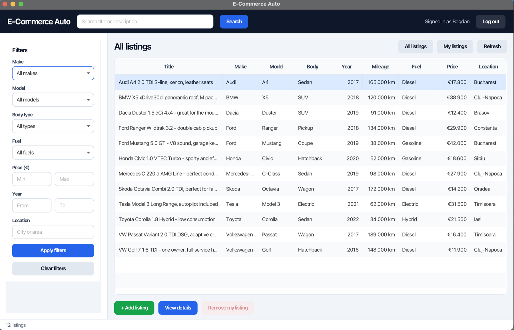
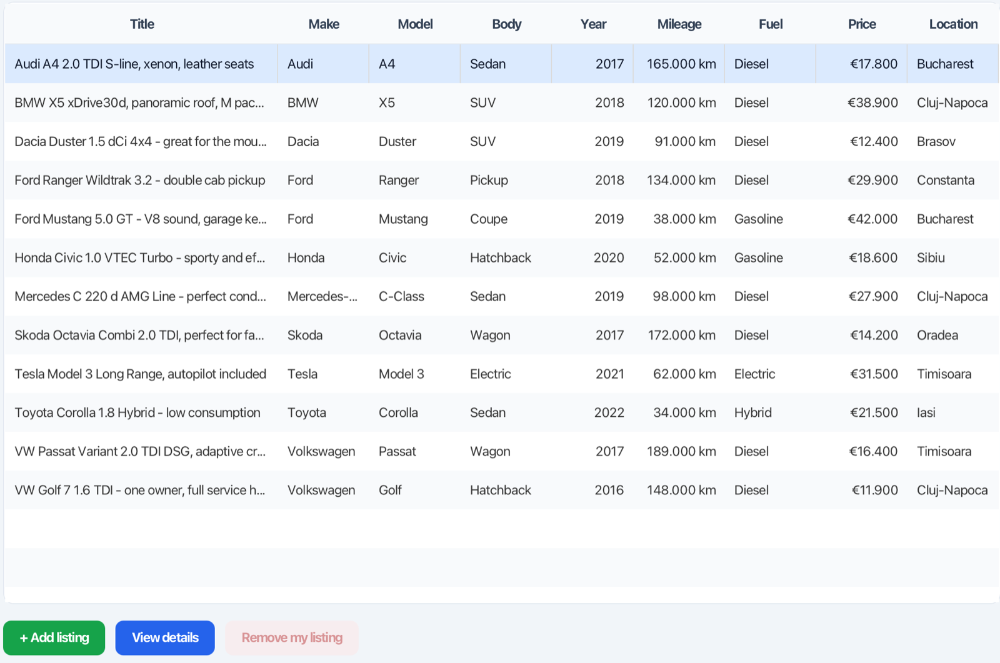
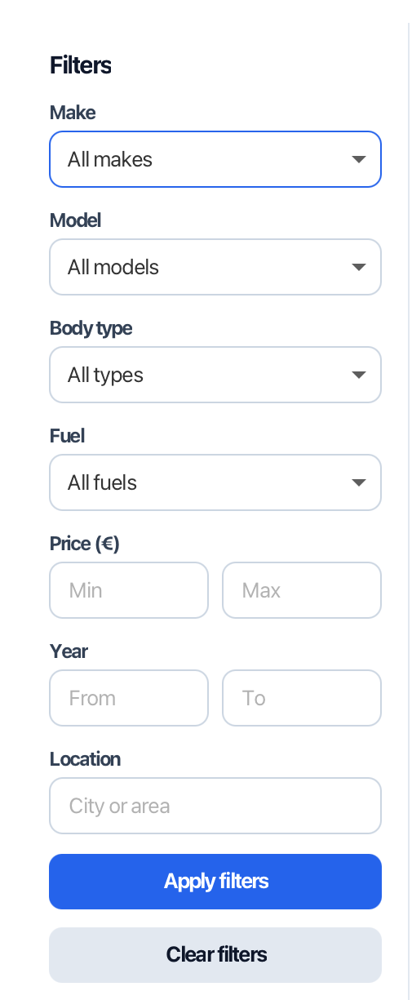
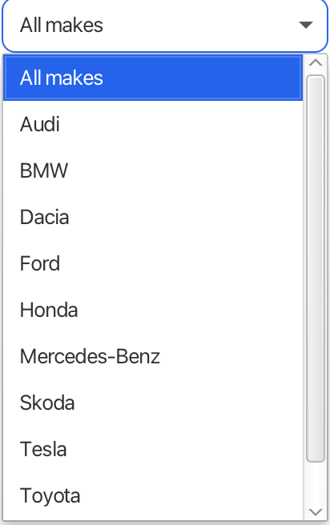
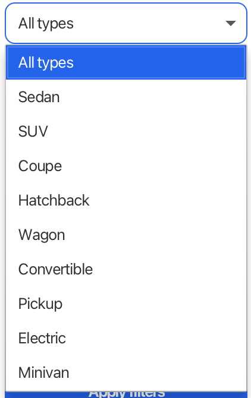
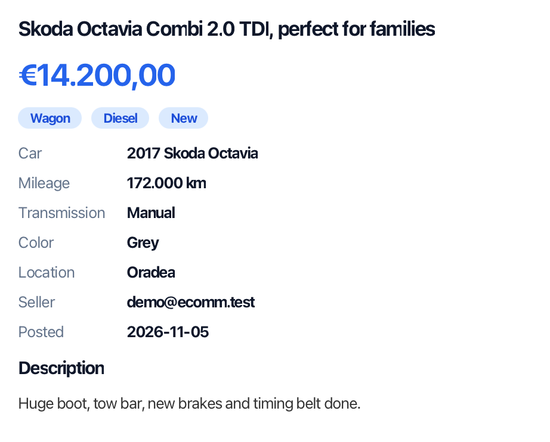

# E-Commerce Auto

A desktop car marketplace (in the spirit of AutoVit / OLX) built with **JavaFX** and **PostgreSQL**.
Users can register, browse and filter car listings, publish their own, and remove them again.



## Feature tour

### Browse listings

A sortable table shows every active listing with make, model, body type, year, mileage, fuel, price and
location. Select a row to see its details, or use the buttons below the table to add a listing, open the
details window, or remove one of your own (the button stays disabled for other people's listings).



### Search and filter

Search the title and description from the top bar, then narrow the results with the filter panel. All
filters combine, and the status bar reports how many listings matched.


<table>
  <tr>
    <td valign="top"></td>
    <td valign="top">
      <br><br>
      
    </td>
  </tr>
</table>

Filters available: make, model (loaded for the chosen make), body type, fuel, price range, year range
and location.

### Listing details

Double-click a row (or press **View details**) for the full picture: price, tags, specifications,
seller and description.



### Also included

Registration and login with salted password hashes, a form for publishing listings with input
validation, a "My listings" view, and clear error messages when the database is not running.

## Features

- Registration and login (salted SHA-256 password hashes, case-insensitive emails)
- Browse all active listings in a sortable table, with a details window for each car
- Search by keyword (title and description) and filter by make, model, body type, fuel, price range,
  year range and location
- Publish a listing with validation (make/model, title, price, year, mileage, fuel, transmission, ...)
- "My listings" view, and soft-delete (listings are deactivated, not erased)
- Clear messages when the database is unreachable instead of a generic login error

## Tech stack

| Layer | Technology |
|---|---|
| UI | JavaFX 21 + FXML, one shared stylesheet (`css/app.css`) |
| Logic | Java 21, controllers per screen |
| Data access | Repository classes using plain JDBC |
| Database | PostgreSQL 17 (Docker) |
| Build / tests | Maven (wrapper included), JUnit 5 |

```
src/main/java/com/ecomm
├── Main.java              application entry point
├── controller/            one controller per screen (login, register, dashboard, add listing)
├── model/                 User, CarMake, CarModel, CarListing, ListingOptions
├── repository/            JDBC queries for each table
└── util/                  DatabaseUtil, PasswordUtil, Navigator, UiUtil
src/main/resources         fxml/ screens and css/app.css
db/                        schema and sample data (run automatically by Docker)
```

## Running it

You need **JDK 21+** and **Docker**.

```bash
# 1. start PostgreSQL with the schema and sample data
docker compose up -d

# 2. run the app
./mvnw javafx:run
```

Log in with the demo account **demo@ecomm.test / Demo1234**, or register your own.

The database listens on host port **5433** so it doesn't clash with a local Postgres on 5432. To use
a different database, set these environment variables before starting the app:

| Variable | Default |
|---|---|
| `DB_URL` | `jdbc:postgresql://localhost:5433/ecomm_auto` |
| `DB_USER` | `ecomm` |
| `DB_PASSWORD` | `ecomm_dev` (development only) |

To reset the data: `docker compose down -v && docker compose up -d`.

## Tests

```bash
./mvnw test
```

The password tests always run. The repository tests run against the Docker database and are skipped
automatically if it isn't running.

## Database schema

`users`, `car_makes`, `car_models` (with `body_type`) and `car_listings` (with an `is_active` flag for
soft delete). See [`db/01-schema.sql`](db/01-schema.sql).

The original project description is in `Project_OOP.docx`.
